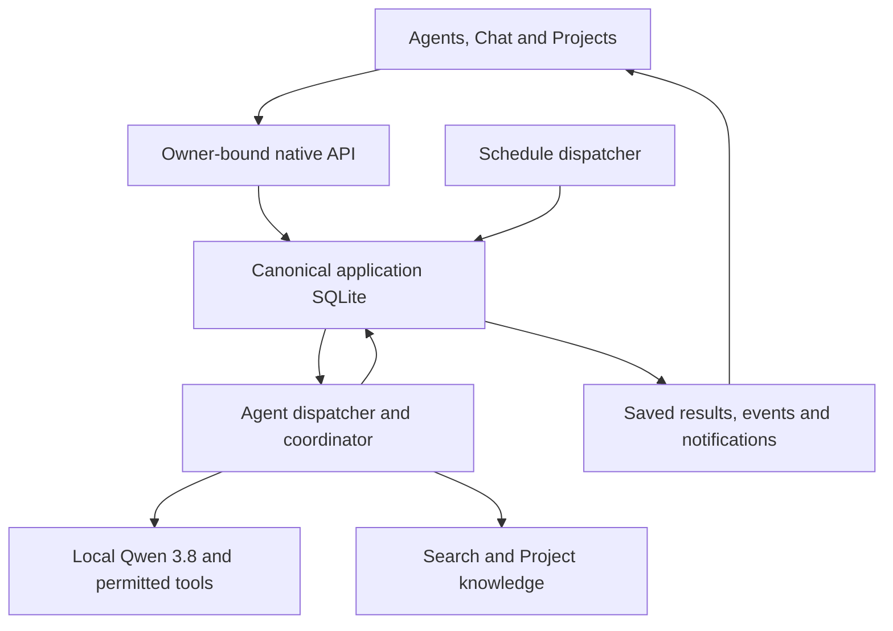

# Audrey agent workspace, search, project knowledge and monitoring

**Status:** In progress, October 29, 2026. The first public-research Agents slice
is implemented locally; Tower/browser acceptance is pending. Campaigns 1–4 remain closed.

The owner selected unified search, saved background tasks, project working
memory and scheduled monitoring. Background tasks mean a visible agentic
architecture: Agents should be a prominent part of Audrey's native UI.
Backups and disaster recovery are outside this plan. Agent restart recovery is
part of the requested background execution capability.

## Current implementation slice

The native app now has primary Chat/Agents navigation and a saved public-source
research workflow: Plan, Research and Review. Users can create tasks, inspect
saved step results/reports, pause/resume/cancel, start a new run and delete terminal
history. Lists return compact summaries and load the selected report separately.

Application schema 26 stores owner-bound tasks and operation reservations with
leases, fenced writes and cumulative limits. The lifecycle worker reuses committed
steps after interruption; uncommitted model/read work can repeat within the saved
allowance. Every provider/tool dispatch revalidates live task/account/model access.
Public agents offer only web search/fetch; automatic personal-memory recall and
file/write tools are excluded. Every model step uses only verified local
`qwen3.8:latest`, with no classifier, cloud panel or fallback. The worker verifies
installed local weights before generation and pins their digest within each step;
missing or changed metadata stops execution. Public web tools still fetch source
material. Model calls share existing admission and generation limits. Account
purge removes the new task data and receipts.

This slice uses a fixed three-stage workflow and the existing bounded ReAct loop.
User-input requests, adaptive multi-step plans, Project/file/Private agent inputs,
foreground-priority enhancements, separate notifications, unified search, Project
knowledge and watches remain implementation work. Existing Private Tax tasks keep
their current behavior. The remaining sections specify the intended full feature.

## Product outcome

A user can give Audrey an objective, choose its Project and sources, start an
agent, and return later to its plan, progress, questions and results. The agent
can perform bounded research and document work, check its progress against the
objective, and continue from committed steps after a backend restart.

The same workspace lets users find saved content, maintain approved Project
knowledge, and schedule recurring checks that produce meaningful change reports.
These are four connected capabilities with one execution foundation.

Example: start an agent to compare selected technical documents and produce a
cited report; find its evidence through Search; approve a proposed Project
decision; then schedule a weekly check of a selected public release page.

## Current foundations

| Area | Already present | Work required |
| --- | --- | --- |
| Native runs | Browser-independent execution, saved messages, model/tool activity and reconnect events | Durable objectives, plans, checkpoints, user-input waits and restart dispatch |
| Private tasks | Leases, revisions, source/model pins, budgets and committed-result delivery for Private tax reviews | General agent contracts and adapters; existing Private recovery currently pauses work |
| Search | Per-user file retrieval, history search, file text and native conversation reads | One native content-search API/UI with canonical targets and usable snippets |
| Projects | Instructions, conversation grouping, selected files and per-run context snapshots | Attributable working knowledge reused across conversations and agent tasks |
| Scheduling | Lifecycle workers and polling patterns for existing maintenance | User-owned schedules, occurrences, baselines, comparisons and notifications |

Code anchors:

- [Native run manager](../../src/audrey/routes/app/runs.py),
  [pipeline graph](../../src/audrey/pipeline/graph.py) and
  [startup](../../src/audrey/main.py).
- [Private task repository](../../src/audrey/app_state/private_tasks.py),
  [admission](../../src/audrey/private_task_admission.py),
  [step runner](../../src/audrey/private_task_runner.py) and
  [delivery](../../src/audrey/private_reviews.py).
- [Project repository](../../src/audrey/app_state/projects.py),
  [context snapshots](../../src/audrey/project_context.py),
  [history search](../../tools-server/chat_archive.py) and
  [guarded public fetch](../../tools-server/fetch.py).

Ordinary run history is durable, but its live execution/event buffer is not a
restartable agent. The existing pipeline compiles without a durable checkpointer;
interrupted ordinary runs become terminal failures on startup. Private tasks are
specialized around Tax cases and deliberately pause on restart. Exposing their
existing routes alone would not deliver the requested architecture.

## Main UI

Add **Agents** beside Chat and Projects in primary desktop/mobile navigation.
Keep an active-work count visible without requiring an open conversation.

The Agents home has New agent task and views for Running, Needs your input,
Scheduled and Finished. Paused/failed work remains accessible with its stop reason.
Cards identify the objective, Project, current stage, last real activity and result.

Each task opens a full workspace containing:

- Objective, success criteria, selected Project/sources and processing mode.
- A visible plan with pending/running/completed steps and bounded replanning.
- Observed activity, findings, source links and produced files.
- Questions that need the user's input, with answers saved against the task.
- Pause, Resume, Cancel and Run again. Run again creates a new historical run.
- Results and proposed Project knowledge updates with links to their provenance.

The visible plan explains intended work; progress reflects observed actions.
Neither is a raw model reasoning transcript. Use stage/step status rather than
invented percentage completion.

Projects gain links to their agents, schedules and Knowledge panel. Search can
open matching messages, file passages, agent results and approved knowledge.
Chat and Project actions can prefill a new task; starting it remains explicit.

## Shared execution design

Start with a lifecycle-owned dispatcher inside Audrey. It must share the existing
GPU gate, per-user admission, discovery and processing policies. The current GPU
gate is process-local; moving work to a separate worker would first require
shared admission. No new orchestration service is required for the initial scope.

One coordinator owns each objective:

`admit -> plan -> execute bounded step -> commit result -> check objective`

The next action is another step, a bounded replan, a saved user question, or a
terminal result. Existing local generation and tool capabilities perform the actual
work. Trusted code validates the proposed steps, dependencies, tools and source
scope. Agent model work is local-only, currently restricted to `qwen3.8:latest`
for planning, execution and review. Cloud models and fallback are excluded.
All child work counts against the same allowance.

### Durable state and recovery

Keep task lifecycle and user-visible state in application SQLite. Proposed
entities, finalized during the first milestone:

| Entity | Purpose |
| --- | --- |
| Agent task | Owner, objective, accepted scope, Project, privacy, sources and limits |
| Agent run | One execution/retry, context manifest, status, usage and stop reason |
| Plan/step | Versioned work plan, dependencies, input identity and committed outcome |
| Attempt/operation | Lease, fencing generation, request identity and tool/output receipt |
| Event | Ordered public activity for reconnect and saved history |
| Input request | A specific question, expected revision and saved response |
| Delivery/notification | Durable result reference, deduplication key and read/delivery state |

Use separate task status and execution stage. Statuses include queued, running,
waiting for user, paused, completed, cancelled and failed; stages describe planning,
execution and checking. Waiting/paused tasks release compute and leases.

Persist explicit step inputs, selected source/context revisions, concise progress,
operation receipts and output references. Do not serialize live coroutine objects
or claim arbitrary instruction-level resumption. Resume at supported committed
step boundaries. A new attempt can repeat uncommitted read/model work within its
remaining allowance; committed outputs must be reused.

Use atomic claims, expiring leases and monotonically increasing fencing values.
Check the fence again before committing progress, attaching an output or delivering
a result. Commit checkpoint/result references and delivery intent together where
they share the application database; use durable receipts across storage boundaries.
Replay committed delivery after restart without duplicate files/messages/notices.

Record an operation identity before dispatching effects. An uncertain external
outcome without a safe idempotency/reconciliation path pauses for review instead
of being blindly repeated. Exactly-once external execution or model billing is
not promised.

The first implementation uses an explicit step controller around existing
pipelines. Evaluate a persistent LangGraph checkpointer where it adds useful
within-step recovery, after confirming installed-version compatibility. Task
state and Project knowledge remain different authorities: LangGraph likewise
distinguishes [thread checkpoints from cross-thread stores](https://docs.langchain.com/oss/python/langgraph/persistence).

### Scope, authority and resource use

Starting a task authorizes the selected read/research and generated-output work.
Routine work inside that scope proceeds without repeated confirmations. Missing
facts create saved input requests. Expanding the objective or performing a new
consequential external action requires a concrete user decision.

Revalidate the active owner, model/tool grants, Project membership, required
sources and processing mode on claim/resume, before each model/tool dispatch or
protected source read, and before committing outputs.
Never persist browser bearer credentials. Snapshot relevant inputs for each run;
material changes require revalidation/replanning, while a Project rename does not.

Bound queued/active work per user and globally, plan steps/replans, model/tool
calls, retries, active execution time, output bytes and event retention in
`config.yaml`. Start conservatively with one active agent task per user. Account
for all attempts and child calls; resume does not reset usage. Reserve resources
before dispatch and conservatively retain charges for unknown outcomes after a
crash until reconciled. User waiting time does not consume active execution allowance.

Extend existing admission to distinguish interactive and background calls, with
aging so neither is starved. Yield at model/step boundaries; do not interrupt an
active GPU generation to implement priority. Track queue wait, checkpoint age,
stops and retries through existing monitoring without private-content labels.

Private processing inherits canonical restrictions. Public web research/watches
are unavailable in Private mode; supported local source work can be enabled only
through verified local adapters. Keep the existing Private Tax task path intact
initially, then expose it through an Agents adapter once its behavior is preserved.

## Unified content search

Build a native Search view and an authenticated `/api/search` service. Derive
ownership from the principal; requests can filter source kind, Project, date and
archive state, but cannot select another user's namespace.

Return typed source IDs, source revision, title, matching excerpt/highlight ranges,
availability and an exact supported navigation target. Search messages and file
contents rather than only titles/filenames. Add agent results and approved Project
knowledge as those entities ship.

Use a dedicated, rebuildable local SQLite search projection for lexical content,
with bounded incremental indexing/backfill. Keep canonical application messages,
upload catalog records and retained artifacts authoritative. Changes and deletion
fences must be checked before backfill or returning any indexed snippet. Verify
FTS5 support in the runtime; explicit indexing/backfill and update/delete handling
are required for [SQLite full-text indexes](https://www.sqlite.org/fts5.html#external_content_tables).

Index completed/incomplete user and assistant messages directly by their native
IDs; exclude in-progress drafts and raw tool messages/results. The existing history archive
uses different derived IDs, so wrapping its search tool does not provide reliable
native message targets. File chunks retain file/artifact identity, content revision
and character offsets. Generated summaries/reports remain labeled as such.

Lexical search ships first. Add semantic candidates through scoped adapters once
canonical identity mapping and local processing are established. Preserve separate
document and history embedding profiles; merge retriever ranks rather than
comparing incompatible raw scores. Deduplicate chunks and limit domination by a
single long source. Exact search remains usable during semantic dependency failure,
with a clear partial-results state.

Results open a bounded native message window or the relevant file artifact and
highlight the match. Page numbers and media seek targets require real stored
locators; use text offsets when those locators do not exist. Do not infer them
from chunk order or generated prose.

All personal-content search is local. Private query text/snippets must not enter
ordinary sidecar history/memory or cloud paths. Native local lexical search can
cover authorized protected records; semantic Private search needs its verified
local adapter and isolated collection. A helper named `search_private_file_text`
currently means ordinary per-user files and excludes protected uploads; it cannot
stand in for the new Private path.

Enforce live Project membership, deletion and source revision after awaited
retrieval. Removed originals can still have valid retained transcripts, but an
index cannot manufacture the missing original. Bound query syntax, candidate
work, pages and snippets; bind pagination to the owner/query/filters. Render
untrusted excerpts as text, never executable HTML.

## Project working memory

Add a canonical Project Knowledge repository with Facts, Decisions, Questions and
Actions, separate from global key/value memory and Tax case records.

Entries have owner/Project IDs, kind, text, approval state, current revision,
creation/edit/approval dates and typed source references. Questions/actions also
have open/resolved/completed state; approving an action does not complete it.
Revisions support corrections, superseding and concurrent-edit conflicts.

Users can create/edit approved entries directly. Agents propose entries or
replacements; only a user can activate them. Task completion never self-approves
memory. Show a conflicting proposal beside the existing entry and its evidence.
Approval records accepted Project knowledge, not independently verified truth.

Support user-authored statements, native messages, inspected file passages and
versioned public-source snapshots. A generated report can identify where a
proposal originated, but its underlying inspected sources supply evidence.
Unsupported inferred suggestions remain explicitly labeled.

Extend Project context snapshots with bounded selected approved entries and their
revisions. Prefer relevant/pinned decisions and open work; set a combined Project
context allowance so knowledge does not crowd out file evidence. Treat entries
as quoted data below platform instructions. Exclude pending/rejected/superseded
and source-dependent stale entries from automatic grounding.

Each agent run records the knowledge revisions it used. Material changes require
explicit revalidation/replanning; do not silently replace the context under an
active run. Agents can propose updates from results and link actions to tasks,
but an action entry does not itself start work or create a schedule.

Project home exposes edit, approve/reject, history, source viewing and stale/conflict
review. Agent results link to proposals; entries link to their producing task and
accessible evidence. Search defaults to current approved knowledge; proposals and
history require explicit filters.

Private knowledge stays within canonical protected storage and verified local
processing. It never enters ordinary global-memory recall or cloud summarization.
Project deletion removes its knowledge/proposals, revision bodies, retained
excerpts and search projections while retaining the established conversation/file
behavior. Account purge includes every new derivative.

Source detachment removes grounding and source-preview links within that Project;
it does not remove the owner's My Files access or previews elsewhere. Source
deletion immediately fences all source reads and dependent automatic grounding.
Remove automatically extracted proposal/entry bodies, revision excerpts, saved
task input copies and owned-file watch snapshots derived solely from that source;
retain only unavailable-source metadata. These copies cannot become alternate
source reads. Explicit user-authored notes and separately saved reports can remain
with a missing-source notice, but are not substitutes for the deleted source.
Deleting those records and account purge remove their bodies and search projections.

## Scheduled monitoring

A watch is an owned, versioned definition that creates agent runs. It records
what to inspect, what changes matter, the authorized source scope, cadence,
IANA timezone, enabled state and notification policy.

Initial watch types:

- Selected public HTML/text URLs through the existing guarded fetcher.
- Selected owned file revisions or additions/revisions within an explicitly
  selected Project file scope. Private file checks use only the local path.

Each occurrence snapshots the sources currently authorized by the saved watch
scope. A Project-file watch can intentionally include later matching additions;
a single agent run still retains its own fixed input manifest.

The first successful check establishes a baseline. Save immutable source snapshots,
checksums, extraction version, check time and per-source coverage. Normalize known
template noise deterministically. Unchanged normalized content can skip model
comparison; changed content receives a bounded diff and evidence-linked explanation
against the user's criterion. Distinguish an observed content change from the
model's judgment about its significance.

Compare only compatible source identities and extraction/normalization versions.
Replacing a source or changing extraction rules establishes a fresh baseline or
an explicit rebaseline; it cannot manufacture a content-change alert. A criterion-only
edit can retain compatible snapshots, bound to the new definition revision.

Failed, blocked, empty or partially read sources never become "no change" and do
not replace the previous valid baseline. Advance each baseline only after its
successful snapshot/report commit. Distinguish normal changes, no change, partial
coverage and degraded checks in the UI.

Schedule defaults:

- Offer daily/weekly wall-clock schedules and bounded intervals; use the user's
  selected IANA zone, with upcoming occurrences previewed. Store execution UTC.
- A nonexistent DST time runs at the first valid instant after the gap; a repeated
  local time runs once. Test the exact library behavior before enabling schedules.
- Coalesce missed occurrences during downtime into one labeled catch-up check.
- Permit one active run per watch and at most one coalesced pending occurrence.
- Use a unique `(watch, definition revision, scheduled occurrence)` identity;
  enqueue and advance the schedule transactionally.
- Pausing/editing/deleting a watch fences affected queued work. Current-definition
  checks prevent an older run from replacing a newer definition's baseline.
- Apply capped retry/backoff and a deduplicated notice for persistent failures.

Saved recurring definitions require an explicit Create watch action. Natural
language can prefill a definition and preview its cadence; casual discussion does
not silently create one. Watches appear in Agents and their Project, with Run now,
Pause, Edit, History and Delete.

Notifications begin with a durable in-app inbox/activity badge. Agent completion,
input requests, relevant watch changes and persistent failures link to the exact
run. Unchanged checks remain in history without repeated notices. External/push
channels are a later explicit opt-in; they carry no Private source content.

Search-query watches, authenticated websites, mailbox/calendar integrations and
arbitrary external actions are outside the initial release. They can later use
the same task/schedule contracts after their source/permission behavior is defined.

## Delivery milestones

| Milestone | Deliverable | Exit condition |
| --- | --- | --- |
| 0 — Shared contracts | Source references, context manifests, lifecycle/revision rules, bounded task schema and Agents navigation design | One agreed contract connects all four features; initial limits and supported step types are explicit |
| 1 — Agents first | Working prominent Agents UI plus one useful research/document workflow, persistent plan/steps, input requests, controls, results and in-app notices | Close browser and restart backend; the task retains committed work and completes without duplicate outputs |
| 2 — Unified search | Local content search, bounded index backfill, typed targets, snippets, filters and deep navigation; semantic enhancement after identity mapping | Find content absent from titles/filenames and open the real matching message/artifact |
| 3 — Project knowledge | Manual approved entries/revisions, bounded cross-chat context, agent proposals and source/stale handling | A decision carries into a later Project chat; an agent proposal stays inactive until approved |
| 4 — Scheduled agents | Watches, timezone-aware occurrence dispatch, snapshots/diffs, baseline management and change/failure notices | Initial baseline, real change, no change, failure, downtime and duplicate wakeups produce distinct correct outcomes |
| 5 — Integrated acceptance | End-to-end Project/Agents/Search/Knowledge/Watch flows and focused recovery/load checks | The user's native-browser workflow succeeds with real sources and preserves all ownership/Private boundaries |

After milestone 0, search and knowledge storage/UI work can proceed independently
while the Agents vertical slice is built. Watches depend on reliable agent runs,
not on completion of semantic search. Deliver each milestone as a reviewable slice;
do not postpone all useful UI until the infrastructure is finished.

## Implementation touchpoints

New module and route names below are proposed, not existing interfaces.

| Layer | Planned changes |
| --- | --- |
| Application state | Add agent/knowledge/watch/notification repositories beside `app_state/projects.py`; register them in `ApplicationStore` with additive migrations |
| Execution | Add an agent coordinator/dispatcher in Audrey's lifespan; use existing pipeline/tool execution and extend shared admission for background priority |
| Source context | Add shared typed source/context manifests; extend `project_context.py` and source resolution without using model-generated paths |
| Search | Add `content_search.py`, a configured rebuildable SQLite projection/indexer, owner-scoped adapters and native message-window resolution |
| Native routes | Add `/api/agents`, `/api/search`, `/api/projects/{id}/knowledge`, `/api/watches` and `/api/notifications`; actions use expected revisions and creation idempotency keys |
| Browser | Add Agents workspace and global Search navigation, task detail/input/result views, in-app notification state and Project Knowledge/agent/watch links |
| Configuration | Add bounded agent/search/knowledge/watch settings to canonical `config.yaml`; retain existing model selection and Private policy authority |

## Verification and rollout

For each slice, run affected hermetic tests and changed-file lint. Key failure
boundaries are:

- Two claims for one step, stale leases, crash before/after commit, lost delivery
  acknowledgement, partial file/output handover and cancellation during completion.
- Waiting for input across restart; stale answers and concurrent edits; bounded
  planner loops, retries and usage across resumed attempts.
- Owner/model revocation, account purge, source deletion or Project changes while
  retrieval/model work is in flight; delayed index writers cannot resurrect access.
- Detach a still-owned file without removing My Files access; delete a source after
  task/watch snapshots exist; delete a Project with knowledge history. Derived
  copies and delayed writers cannot bypass the relevant deletion or scope change.
- Lexical indexing backfill/update/delete correctness, hostile query syntax,
  duplicate filenames, native message anchors, missing artifacts and semantic outage.
- Conflicting knowledge revisions, inactive proposals, stale sources, Project
  isolation and bounded context with large collections.
- DST transitions, downtime catch-up, overlapping checks, schedule edits, partial
  fetches, unchanged content and duplicate alerts.
- Interactive chat responsiveness during agent work, eventual background progress,
  and Private requests making no ordinary memory/history/cloud/web calls.

Native acceptance is manual-first: start real work, leave/reconnect, answer an
input request, inspect results, find evidence, approve a knowledge proposal and
observe a controlled watch change. Hermetic pass counts do not establish model
answer quality; use task-specific success criteria and inspect actual outputs.

Implement and verify on the laptop checkout. The owner pulls and deploys on Tower
from `/mnt/user/appdata/audrey_ai_2.0`; backend/UI slices require the appropriate
`audrey`/`audrey-ui` rebuilds, and changed bind-mounted configuration requires service
recreation. Provide exact per-slice commands and required real inputs with each
handoff. The implemented first slice requires backend/UI rebuilds and backend
recreation; its public research workflow requires no upload.

## Initial implementation boundaries

Use existing identity, model policies, tool declarations, file/output ownership,
Private enforcement and native application infrastructure. Additive migrations
must preserve canonical data. Existing Tax reviews, ordinary chat and Hermes'
separate tool/document workspace retain their contracts.

The first code slice is milestone 0 plus the smallest complete milestone-1 agent
workflow. Choosing an external notification channel or adding a separate worker
service does not block that slice. This plan authorizes no deployment, schedule
activation, external messages or runtime source changes by itself.
